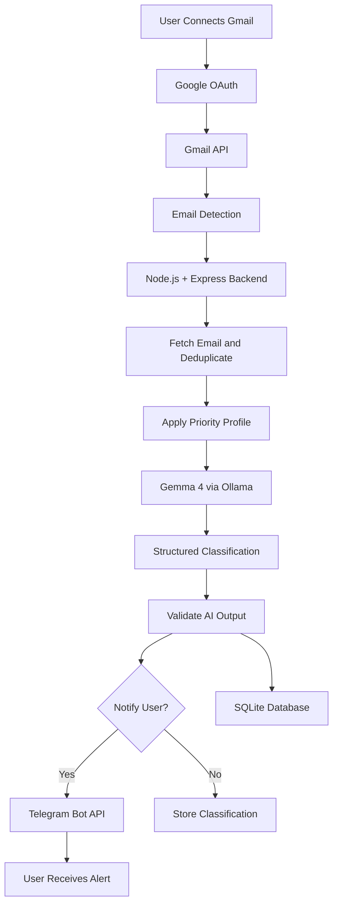

# 🛡️ Inbox Sentinel
### Your Personal AI for Emails That Matter.

Inbox Sentinel is an AI-powered email assistant that identifies important opportunities from your inbox based on your personal goals, priorities, and preferences.

Instead of constantly checking emails and risking missed opportunities, users connect their personal email account, define what matters to them, and let **Gemma 4** analyze incoming emails for relevance, deadlines, and recommended actions.

From placement drives and internship openings to interview calls, coding assessments, scholarships, and exam notices, Inbox Sentinel helps ensure that important emails get the attention they deserve.

## 💡 The Problem

People receive dozens of emails every day, but not every email deserves their attention.

Important messages often get buried under newsletters, promotional emails, routine announcements, and other notifications. Traditional email filters primarily rely on fixed rules and keywords, which can miss opportunities that matter to a particular individual.

For example, an email announcing a recruitment drive might not contain the word "urgent," yet missing its registration deadline could mean losing an important career opportunity.

**Inbox Sentinel focuses on personal relevance, not just urgency.**

## ✨ Key Features

- **Personalized AI Classification:** Gemma 4 evaluates emails against a user's individual goals and preferences.
- **Opportunity Detection:** Identifies relevant placement drives, internships, interview calls, coding assessments, scholarships, and other user-defined priorities.
- **Deadline Extraction:** Identifies registration deadlines, interview dates, assessment schedules, and other time-sensitive details.
- **Explainable Decisions:** Explains why an email matters to the user.
- **Proactive Telegram Alerts:** Sends notifications when incoming emails match the user's priorities.
- **Customizable Priority Profiles:** Users can define and update their priorities using natural language.
- **Duplicate Prevention:** Avoids sending repeated notifications for the same email.
- **Deadline Reminders:** Planned follow-up reminders for approaching deadlines.
- **Local AI Inference:** Uses Gemma 4 through Ollama during development, reducing dependence on external AI inference services.

## 🏗️ System Architecture

**Initial implementation:** Email polling will be used to simplify the first working prototype. Provider-supported push notifications can be introduced later to reduce unnecessary polling and improve responsiveness.

The architecture represents the planned system; components will be marked as implemented as development progresses.

## ⚙️ Technology Stack

| Component | Technology | Purpose |
|---|---|---|
| Frontend | React + Vite | Email connection, priority settings, and classification history |
| Backend | Node.js + Express | Email processing and application orchestration |
| AI Model | Gemma 4 | Contextual email analysis and deadline extraction |
| Inference Runtime | Ollama | Local model inference during development |
| Email Integration | Gmail API | Accessing authorized Gmail accounts |
| Authentication | Google OAuth 2.0 | User sign-in and mailbox authorization |
| Initial Email Detection | Polling | Checking for new messages |
| Database | SQLite | User preferences and processed email records |
| Notifications | Telegram Bot API | Delivering important-email alerts |
| Version Control | Git + GitHub | Collaborative development and open-source contributions |

**Future extensions:** Microsoft Graph for Outlook accounts, provider push notifications, WhatsApp alerts, and a more comprehensive dashboard.

## 🔄 How It Works

1. **Connect Email:** The user authorizes Inbox Sentinel to access their Gmail account.
2. **Define Priorities:** The user describes the types of emails they care about.
3. **Detect New Emails:** The backend periodically checks for new messages.
4. **Prepare Email Data:** The backend retrieves relevant email content and checks whether the message has already been processed.
5. **Analyze with Gemma 4:** The model evaluates the email using the user's priority profile.
6. **Extract Relevant Information:** The model identifies the category, importance, reasoning, deadline, and recommended action.
7. **Validate the Result:** The backend validates the model's structured response and records the classification.
8. **Send Notification:** If the email warrants attention, the Telegram bot sends the user an alert.
9. **Track Opportunities:** Classification history and deadline reminders help users keep track of important messages.

## 🧠 Why Gemma 4?

Inbox Sentinel uses Gemma 4 as a personalized email reasoning engine rather than a generic chatbot.

Users can define priorities in natural language, such as:

> I am preparing for campus placements. Prioritize placement drives, registration deadlines, interview calls, coding assessments, scholarships, and exam-related announcements. Ignore routine promotional emails. Explain why an email matters and extract its deadline.

Gemma evaluates each email in the context of those preferences instead of relying exclusively on keywords such as "urgent" or "important."

For example, an email announcing that recruitment registration closes tomorrow may deserve an alert even if its subject does not explicitly indicate urgency.

The application separates responsibilities deliberately:

- **Gemma 4:** Understands email content, evaluates relevance, and extracts information.
- **Backend:** Handles authentication, email retrieval, scheduling, validation, deduplication, and notification delivery.
- **Telegram:** Delivers alerts to the user.

This separation makes the system easier to test, maintain, and extend.

## 🔔 Example Notification

**🚨 Important Placement Opportunity**

**Subject:** Campus Recruitment Drive — Registration Closes Tomorrow

**Category:** Placement

**Why it matters:** This recruitment opportunity matches your placement priorities.

**Deadline:** Extracted from the email; verify the exact date and time in the original message.

**Recommended action:** Review the eligibility criteria and register before the deadline.

## 👤 User Experience

Inbox Sentinel is intended to be simple enough for a student or professional to set up without understanding APIs or AI infrastructure.

The planned onboarding flow is:

1. Open the Inbox Sentinel web application.
2. Connect a supported email account.
3. Define personal priorities.
4. Connect a Telegram account through the Inbox Sentinel bot.
5. Enable email monitoring.
6. Receive alerts when relevant opportunities arrive.

A minimal dashboard will allow users to edit their preferences, view recent classification decisions, and manage their notification settings.

The initial prototype prioritizes a complete, working email-to-AI-to-Telegram pipeline over a large collection of interface features.

## 🔐 Privacy and Security

Inbox Sentinel is designed around explicit user authorization and minimal data access.

- Users authorize access to their own email accounts.
- The application requests only the permissions necessary for its implemented features.
- OAuth tokens and credentials must be stored securely and never committed to the repository.
- Email content should not be retained longer than necessary.
- AI-generated classifications and extracted deadlines must be treated as potentially incorrect until validated.
- Email content is treated as untrusted input, not as instructions to execute tools or actions.
- Users should be able to disconnect their email account and revoke access.

Local inference reduces dependence on external AI inference services, but it does not automatically make the entire application private. Email-provider APIs, Telegram, logging, and hosting infrastructure must also be considered.

## 🚧 Development Roadmap

### Phase 1 — Working Prototype

- [ ] Set up the repository, README, and open-source license.
- [ ] Integrate Gmail OAuth and verify authorized mailbox access.
- [ ] Retrieve emails through the Gmail API.
- [ ] Implement polling and duplicate prevention.
- [ ] Integrate Gemma 4 through Ollama.
- [ ] Define and validate a structured AI classification schema.
- [ ] Implement personalized priority profiles.
- [ ] Extract deadlines and recommended actions.
- [ ] Integrate Telegram Bot API.
- [ ] Demonstrate important and routine emails end to end.

### Phase 2 — Usable Application

- [ ] Build a minimal React dashboard.
- [ ] Add classification history and priority editing.
- [ ] Improve error handling, retries, and logging.
- [ ] Implement deadline reminders.
- [ ] Add automated tests and GitHub Actions checks.
- [ ] Evaluate classification quality and end-to-end latency.

### Phase 3 — Future Enhancements

- [ ] Add Outlook support through Microsoft Graph.
- [ ] Introduce provider-supported push notifications.
- [ ] Add WhatsApp notifications through the official Business Platform.
- [ ] Support multiple email accounts.
- [ ] Improve preference management and notification controls.
- [ ] Explore additional deployment and inference options.

## ⚠️ Current Limitations

- Gmail is the initial integration target; Outlook support is planned.
- Email access depends on OAuth permissions, provider policies, and applicable verification requirements.
- Polling can introduce delays and unnecessary API requests.
- Local inference requires a compatible machine or an accessible inference server.
- Telegram users must initiate or connect with the bot before receiving messages.
- WhatsApp integration is not part of the initial prototype.
- Extracted deadlines may be ambiguous or incomplete and should be verified against the original email.
- AI classifications may be incorrect and should be evaluated against representative test cases.

## 🚀 Getting Started

The project is under active development. Detailed setup instructions will be added as the initial implementation becomes available.

### Prerequisites

- Node.js and npm
- Ollama installed on a compatible machine
- A compatible Gemma 4 model available through the selected inference runtime
- A Google Cloud project with the Gmail API enabled
- OAuth credentials configured for the application
- A Telegram account and bot created using BotFather

### Planned Setup

1. Clone the repository.
2. Install backend and frontend dependencies.
3. Configure environment variables using the example configuration.
4. Start Ollama and make the selected Gemma model available.
5. Configure Google OAuth and Gmail API access.
6. Configure the Telegram bot and connect a test chat.
7. Start the backend and frontend.
8. Test the pipeline using a dedicated test inbox before enabling monitoring on a personal mailbox.

Exact installation commands and configuration will be documented alongside the implemented features.

## 🤝 Contributing

Contributions are welcome!

1. Open or identify an issue describing the task.
2. Create a dedicated branch for the issue.
3. Make
